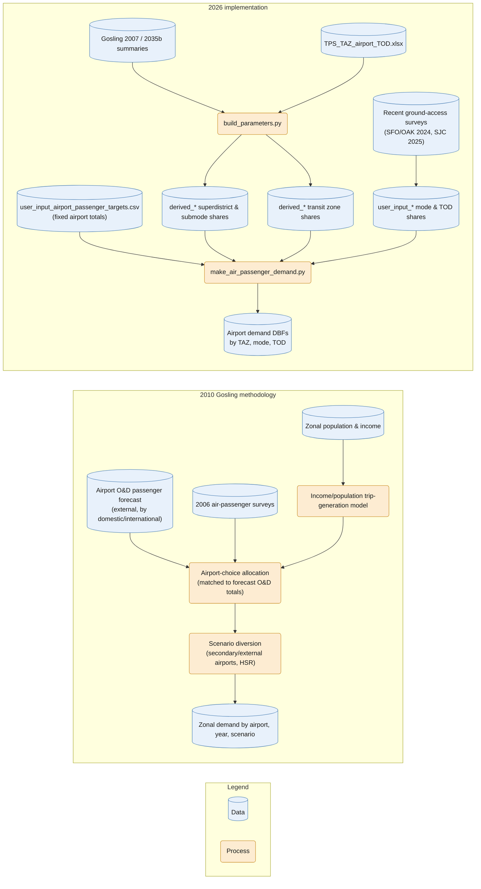

# Airport Passenger Demand Workflow

This workflow creates airport ground-access demand matrices for OAK, SFO, and SJC. User-maintained assumptions and source datasets are stored separately from source-derived parameter tables so the model inputs can be reviewed and regenerated when needed.

## Directory layout

```text
.
├── build_parameters.py
├── make_air_passenger_demand.py
├── parameters/
│   ├── README.md
│   └── *.csv
└── output/
    └── *.dbf
```

The model TAZ correspondence remains in the model geography directory. By default, both scripts read:

```text
../../geographies/taz-superdistrict-county.csv
```

relative to the script directory. 

## Workflow

`build_parameters.py` creates the source-derived parameter CSVs from the Gosling airport summaries, `TPS_TAZ_airport_TOD.xlsx`, the model geography, and the user-maintained assumptions in `parameters/`.

`make_air_passenger_demand.py` reads the parameter CSVs, assembles the required TOD/access-mode/submode combinations in memory, and writes the airport demand DBFs to `output/`.

## Run

For a normal model run using the existing parameter CSVs:

```bash
python make_air_passenger_demand.py
```

For a full source-to-output run that first rebuilds the source-derived parameter CSVs:

```bash
python make_air_passenger_demand.py --rebuild-parameters
```

The parameter files may also be rebuilt independently:

```bash
python build_parameters.py
```

See `parameters/README.md` for the parameter manifest, editability guidance, and source descriptions.

## What changed from the original (2010 Gosling) methodology

The original airport ground-access demand method is documented in `2010 June Demand Allocation Methodology (final).pdf` (summarized in `2010 June GoslingSummary.docx`, both in the Box `Airports` folder). Both the 2010 and 2026 methods share the same starting point — a passenger total for each airport, supplied from outside this workflow — and both exist to spread that total across geography, mode, and time period. They differ in how much further forecasting/segmentation happens before that geographic spread, and in whether airport choice and alternative-scenario diversion are modeled at all. The steps below line up the two approaches in the order each one executes them:

| Step | 2010 Gosling methodology | 2026 implementation |
|---|---|---|
| 1. Starting point | Airport-specific forecast domestic/international O&D passenger totals for 2007/2020/2035, from an external aviation-demand forecast (not produced by this methodology). | Airport-specific passenger totals by direction and model year, fixed in [`user_input_airport_passenger_targets.csv`](parameters/user_input_airport_passenger_targets.csv).<br>*[`build_parameters.py`](build_parameters.py): `load_primitive_parameters()`. [`make_air_passenger_demand.py`](make_air_passenger_demand.py): `load_and_prepare()`.* |
| 2. Market segmentation | Splits each airport's total into 4 segments per domestic/international category: resident/visitor x home-origin/non-home-origin. | No segmentation — a single total per airport/direction/year.<br>*Not implemented.* |
| 3. Geographic distribution | Home-origin resident trips: forecast per zone from population and household income, anchored to the 2006 survey pattern with zone adjustment factors. Other segments: held at fixed 2006 survey shares. External zones: held at a fixed 2006 regional share. | Superdistrict shares taken directly from the Gosling 2007 (model year 2023) or 2035b (model year 2050) summaries, with no re-estimation. Within-superdistrict TAZ shares: 2007 Gosling summary (non-transit) or TPS transit survey data (transit).<br>*[`build_parameters.py`](build_parameters.py): `build_super_district_shares()`, `build_airport_non_transit_zone_access_mode_shares()`, `build_airport_transit_zone_shares()`. [`make_air_passenger_demand.py`](make_air_passenger_demand.py): `build_expanded_od()`.* |
| 4. Airport allocation | Zone-level demand allocated among SFO/OAK/SJC using survey-based airport-choice shares, scaled to match each airport's forecast O&D total from step 1. | Not needed — demand is already specified per airport in step 1.<br>*Not implemented.* |
| 5. Scenario adjustment | Optional: redistributes demand for secondary-airport, external-airport, or high-speed-rail scenarios, using diversion rates applied uniformly within each catchment area. | Not implemented — only a single baseline-equivalent split is produced.<br>*Not implemented.* |
| 6. Mode / submode split | Outside the scope of this methodology document. | Non-transit submode (DA/S2/S3) from Gosling summaries; transit vs. non-transit split and non-transit access mode from recent ground-access surveys (SFO/OAK 2024, SJC 2025 ASQ).<br>*[`build_parameters.py`](build_parameters.py): `build_airport_non_transit_submode_shares()`, `build_airport_non_transit_tod_access_mode_submode_shares()`, `build_airport_transit_tod_access_shares()`. [`make_air_passenger_demand.py`](make_air_passenger_demand.py): `load_and_prepare()`, `build_nontransit_person_df()`, `person_to_vehicle()`.* |
| 7. Time-of-day split | Outside the scope of this methodology document. | Separate transit and non-transit TOD shares, from TPS transit summaries and recent ground-access surveys.<br>*[`build_parameters.py`](build_parameters.py): `build_airport_non_transit_tod_access_mode_submode_shares()`, `build_airport_transit_tod_access_shares()`. [`make_air_passenger_demand.py`](make_air_passenger_demand.py): `load_and_prepare()`, `build_nontransit_person_df()`, `build_transit_person_df()`.* |
| 8. Output | Zonal (TAZ/superdistrict/external-zone) person-trip demand by airport, market segment, year, and scenario. | TAZ-level vehicle/person-trip matrices by access mode and time-of-day period, written to DBFs for model years 2023 and 2050.<br>*[`make_air_passenger_demand.py`](make_air_passenger_demand.py): `build_nontransit_person_df()`, `person_to_vehicle()`, `build_transit_person_df()`, `run()`, `write_dbf()`.* |

In short, both methods take airport-level passenger totals as a given and reuse the Gosling survey data to shape the geographic distribution; the 2026 workflow drops the segmentation, re-forecasting, and scenario-diversion steps in between, applying the Gosling-era (and newer survey) shares directly to the fixed totals.

Data sources/tables are drawn as cylinders; processing steps are drawn as rounded boxes. Click a node to open its source file (scripts and CSVs link into this repo; surveys and summaries link to the Box `Airports` folder).


